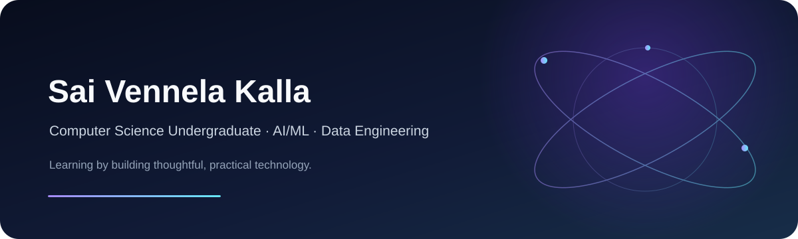

  

  <a href="https://www.linkedin.com/in/sai-vennela-kalla-9999a02b8/">LinkedIn</a> &nbsp;✦&nbsp;
  <a href="mailto:saivennel.kalla7@gmail.com">Email</a> &nbsp;✦&nbsp;
  <a href="https://github.com/Saivennela-kalla">GitHub</a>

## ✦ A little about me

Computer Science undergraduate at **Gayatri Vidya Parishad College of Engineering** (class of 2028), exploring how software, cloud data, and AI can solve practical problems. I’ve worked on AWS data pipelines and an AI-powered commerce application, and I’m looking for an internship where I can keep learning by building.

`VISAKHAPATNAM, INDIA` · `B.TECH CSE '28` · `OPEN TO INTERNSHIPS`

## ✦ My toolkit

**Languages**  
    

**Cloud & data**  
      

**Web, AI & tools**  
     

## ✦ Selected work

<table>
  <tr>
    <td width="50%" valign="top">
      <h3>☁️ AWS Sales Pipeline</h3>
      
Built a cloud workflow to ingest, validate, transform, and analyze sales data. Added data quality handling for duplicate and invalid records.

      Amazon S3 · AWS Glue · Athena · Redshift
    </td>
    <td width="50%" valign="top">
      <h3>✧ Vennela AI Commerce</h3>
      
Created an AI-powered commerce application, combining web technologies, API integration, and AI concepts in an intelligent application workflow.

      HTML · CSS · TypeScript/Java · APIs
    </td>
  </tr>
</table>

## ✦ GitHub at a glance

  
  

## ✦ Beyond the code

- **AWS Data Engineering Virtual Internship** — EduSkills Virtual
- **Certifications:** Oracle Cloud Infrastructure AI Foundations Associate; AWS Academy Data Engineering Training Badge; Claude 101, Claude Platform 101, AI Fluency and Foundations
- **Community:** AsCI (Association of Computer Intellects)
- **Event:** Razorpay Hackathon participant

   
  <i>Curious by nature. Building one project at a time.</i>

